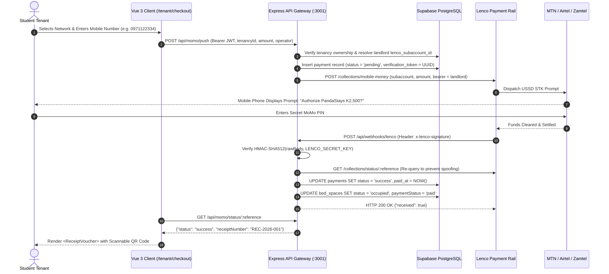

# PandaStays Architecture & Security Specification

**Document Version:** 1.0.0 (Production Release)  
**Standard:** C4 Model / ISO 27001 Security Architecture Guidelines  
**Status:** Approved  
**Security Classification:** Confidential / Proprietary  

---

## 1. Architectural Philosophy & Core Decisions

PandaStays is engineered to address the specific economic and infrastructural realities of student housing in the Republic of Zambia. The system architecture is guided by five foundational architectural decisions (ADRs):

### ADR-1: The Bed-Space as the Atomic Rentable Unit
- **Context:** Unlike standard property management software where apartments or whole houses are the rentable entity, Zambian student boarding houses accommodate 2 to 8 students per shared room.
- **Decision:** Every financial transaction, tenancy lease, maintenance ticket, and reminder is scoped to the **individual bed-space** (`bed_spaces.id`), not the room or building.
- **Impact:** Landlords gain visibility into room-level profitability and individual student arrears without ambiguity.

### ADR-2: PostgreSQL Row-Level Security (RLS) for Kernel-Level Multi-Tenancy
- **Context:** Storing all landlords in a shared database requires mathematical guarantees against cross-tenant data leakage.
- **Decision:** Multi-tenancy isolation is enforced at the database engine level via PostgreSQL RLS policies tied to `auth.uid()`, rather than relying solely on application-level `WHERE` clauses.
- **Impact:** Even if a frontend query omits a landlord filter, the database kernel strictly suppresses rows belonging to other landlords.

### ADR-3: Hybrid Edge Client + Privileged Backend Gateway
- **Context:** Client applications should query the database directly for fast performance, but sensitive payment webhooks, sub-account credentials, and telecom push dispatches require elevated privileges.
- **Decision:** Deploy Vue 3 to the edge (Vercel) using Supabase anonymous tokens under RLS, paired with a lightweight Node.js/Express service on Port `3001` with `SUPABASE_SERVICE_ROLE_KEY` for privileged payment reconciliation and webhook processing.

### ADR-4: Lenco Sub-Account Segregation (Non-Custodial Architecture)
- **Context:** Pooling rent from multiple landlords into a single startup bank account introduces regulatory compliance overhead (clearing house licensing) and insolvency risk.
- **Decision:** Every landlord registers a `lenco_subaccount_id`. Mobile money collections route settlements directly into the respective landlord's sub-account via Lenco API v2. PandaStays operates non-custodially.

### ADR-5: Unguessable Cryptographic Tokens for Public Receipt Verification
- **Context:** Students, university bursars, and guardians need to verify receipts without logging into the platform or exposing private landlord account data.
- **Decision:** Every payment record is assigned an unguessable UUID v4 `verification_token`. The public verification route (`/verify/:token`) queries strictly by this token and returns a sanitized public view.

---

## 2. Relational Data Model & Schema Map

```
┌────────────────────────────────────────────────────────────────────────────────────────┐
│                                   DATABASE ENTITY MAP                                  │
└────────────────────────────────────────────────────────────────────────────────────────┘

 ┌─────────────────────────┐           ┌───────────────────────────┐
 │       auth.users        │           │         landlords         │
 │  (Supabase Auth Engine) │           ├───────────────────────────┤
 │  id: UUID (PK)          │◄──────────┤ id: UUID (PK, FK)         │
 └─────────────────────────┘           │ name: VARCHAR             │
                                       │ email: VARCHAR            │
                                       │ phone: VARCHAR            │
                                       │ lenco_subaccount_id: TEXT │
                                       └─────────────┬─────────────┘
                                                     │ 1:N
                                                     ▼
                                       ┌───────────────────────────┐
                                       │        properties         │
                                       ├───────────────────────────┤
                                       │ id: UUID (PK)             │
                                       │ landlord_id: UUID (FK)    │
                                       │ name: VARCHAR             │
                                       │ address: TEXT             │
                                       └─────────────┬─────────────┘
                                                     │ 1:N
                                                     ▼
                                       ┌───────────────────────────┐
                                       │           rooms           │
                                       ├───────────────────────────┤
                                       │ id: UUID (PK)             │
                                       │ property_id: UUID (FK)    │
                                       │ room_number: VARCHAR      │
                                       │ capacity: INTEGER         │
                                       └─────────────┬─────────────┘
                                                     │ 1:N
                                                     ▼
 ┌─────────────────────────┐           ┌───────────────────────────┐
 │         tenants         │           │        bed_spaces         │
 ├─────────────────────────┤           ├───────────────────────────┤
 │ id: UUID (PK)           │           │ id: UUID (PK)             │
 │ auth_user_id: UUID (FK) │           │ room_id: UUID (FK)        │
 │ name: VARCHAR           │           │ label: VARCHAR            │
 │ email: VARCHAR          │           │ rent_amount: NUMERIC      │
 │ phone: VARCHAR          │           │ status: vacant|occ|res    │
 │ id_number: VARCHAR(NRC) │           └─────────────┬─────────────┘
 └────────────┬────────────┘                         │ 1:N
              │                                      │
              └──────────────┐        ┌──────────────┘
                             │ 1:N    │ 1:N
                             ▼        ▼
                      ┌────────────────────────────┐
                      │         tenancies          │
                      ├────────────────────────────┤
                      │ id: UUID (PK)              │
                      │ bed_space_id: UUID (FK)    │
                      │ tenant_id: UUID (FK)       │
                      │ rent_amount: NUMERIC       │
                      │ start_date: DATE           │
                      │ end_date: DATE (Nullable)  │
                      │ status: active|ended       │
                      └─────────────┬──────────────┘
                                    │ 1:N
                                    ▼
                      ┌────────────────────────────┐
                      │          payments          │
                      ├────────────────────────────┤
                      │ id: UUID (PK)              │
                      │ tenancy_id: UUID (FK)      │
                      │ amount: NUMERIC            │
                      │ method: momo_mtn|airtel|...│
                      │ gateway_reference: VARCHAR │
                      │ receipt_number: VARCHAR    │
                      │ verification_token: UUID   │
                      │ status: pend|succ|fail|rev │
                      │ paid_at: TIMESTAMPTZ       │
                      └────────────────────────────┘
```

---

## 3. Row-Level Security (RLS) Policy Matrix

| Table | Operation | Role | Policy Name | Enforcement Mechanism |
| :--- | :--- | :--- | :--- | :--- |
| `landlords` | `SELECT` | Authenticated | `landlords_select_own` | `auth.uid() = id` |
| `landlords` | `UPDATE` | Authenticated | Column-level Grant | Restricted to `(name, phone, whatsapp_reminder_days_before)`. Direct updates to `lenco_subaccount_id` revoked. |
| `properties`| `ALL` | Authenticated | `properties_all_own` | `landlord_id = auth.uid()` |
| `rooms` | `ALL` | Authenticated | `rooms_all_own` | `EXISTS (SELECT 1 FROM properties p WHERE p.id = rooms.property_id AND p.landlord_id = auth.uid())` |
| `bed_spaces`| `ALL` | Authenticated | `bed_spaces_landlord_all` | Relational join chain asserting `properties.landlord_id = auth.uid()` |
| `bed_spaces`| `SELECT` | Tenant | `bed_spaces_tenant_select_own` | Asserts tenancy linked to bed has `tenants.auth_user_id = auth.uid()` |
| `tenants` | `SELECT` | Landlord | `tenants_landlord_select` | Asserts tenant has an active tenancy on a bed belonging to landlord's property |
| `tenants` | `SELECT` | Tenant | `tenants_select_own` | `auth_user_id = auth.uid()` |
| `tenancies` | `ALL` | Landlord | `tenancies_landlord_all` | Relational join through bed_space and room asserting landlord ownership |
| `tenancies` | `SELECT` | Tenant | `tenancies_tenant_select_own`| Asserts `tenant.auth_user_id = auth.uid()` |
| `payments` | `SELECT` | Landlord | `payments_landlord_select` | Relational join through tenancy asserting landlord ownership |
| `payments` | `SELECT` | Tenant | `payments_tenant_select_own` | Asserts tenancy belongs to student with `auth_user_id = auth.uid()` |
| `payments` | `INSERT/UPDATE`| Client | **None** | Completely revoked from `anon` and `authenticated`. Writes restricted to server service-role. |

---

## 4. End-to-End Mobile Money Payment & Webhook Lifecycle



---

## 5. Security Audit Log & Review Round Hardening

PandaStays has undergone four comprehensive security review cycles. All documented defects and security controls have been validated:

1. **Review Round 1 (Subaccount Isolation):**
   - Fixed: Eliminated pooled landlord collections; introduced sub-account routing per property.
2. **Review Round 2 (Unguessable Receipt Tokens):**
   - Fixed: Replaced incremental primary key references in public verification URLs with cryptographically random UUID v4 tokens.
3. **Review Round 3 (Fail-Closed Backend Gateway):**
   - Fixed: Added startup checks that verify `LENCO_SECRET_KEY` and `SUPABASE_SERVICE_ROLE_KEY` existence; crashes immediately if missing rather than failing silently.
   - Fixed: Added rate limits, Helmet security headers, and strict CORS whitelisting.
4. **Review Round 4 (Database Level Column Revocation):**
   - Fixed: Revoked table-level `UPDATE` permissions on `landlords` for `anon` and `authenticated`.
   - Fixed: Granted updates only to non-sensitive columns (`name`, `phone`, `whatsapp_reminder_days_before`), preventing landlords from tampering with their assigned `lenco_subaccount_id`.
   - Fixed: Added unique constraints on `payments.gateway_reference` to guarantee webhook idempotency.
   - Fixed: Enabled constant-time HMAC verification (`timingSafeEqual`) on webhook signatures.
